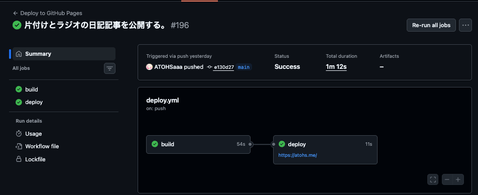

このブログは、Astroを使って運用しています。少し前まで、GitHub Pagesを使って公開していました。記事を公開するときは`git push`するだけ。pushしたあとGitHub Actionsがビルドしてくれて、GitHub Pagesで公開される、という流れです。

構成も単純だし手軽で良いのですが、これには一つ問題がありました。pushしてから、公開されるまでに少し時間がかかるんですよね。

以下のスクリーンショットは、[「片付けができないならラジオを聴けばいいじゃない」](/blog/if-you-cant-tidy-up-listen-to-the-radio/)という記事を公開したときのActionsの様子なのですが、ビルドとデプロイをあわせて1分かかっていました。

記事をpushしたときのActions

ブログを公開するだけで1分も待たされるのは、ちょっと面倒です。記事を公開したら、その場でTwitterに投稿したいのですが、本番に反映されるまで待たなければなりません。1分も待っていると、他のことをし始めて、投稿を忘れるなんてこともあるんですよね。

そこで改善策を考え、本番をCloudflare Workersの静的配信に移行することにしました。記事公開は手元から `npm run ship` を実行する方式に変え、本番反映までの時間が十数秒まで短縮されました。

## はじめに（何を計測したか）

ここで言う「本番反映まで」は、僕が操作を終えてから、本番URLに新しいHTMLが載るまでの時間です。ブラウザのキャッシュやCDNの都合で、読者全員が同時に新しい見た目になるとは限りません。

計測の材料は次のとおりです。

- 以前: GitHub Actionsの「Deploy to GitHub Pages」ワークフローが成功したrunを50件ほど集計
- いま: 手元で `npm run ship` を実行したときの端末ログ（代表例が1回）

## 以前：GitHub Pages + GitHub Actions

### pushするだけで本番が更新される

これまでの本番反映の流れは、次のとおりです。

- `main` に push すると、Actionsが `npm ci` → `npm run build`
- Pages用artifactのupload
- `deploy-pages`

GitHubのActionsタブを見て、緑になったら公開完了です。

そのため、基本的にローカルで `npm run build` は行っていませんでした。

### 待ち時間の実測（ワークフロー全体・中央値約50秒）

成功したrun 50件の開始から完了までを見ると、中央値は約50秒、平均は約54秒でした（短いもので38秒、長いもので114秒くらい）。

体感の「1分弱」は、だいたいこの数字と一致しています。

### 内訳の目安（build 約25秒、deploy 約12秒）

ちなみに、ジョブに分けると、だいたい次のようになります（直近のrunのログから）。

- buildジョブ: 平均約25秒（checkout、`npm ci`、Astroビルド、artifact作成）
- deployジョブ: 平均約12秒（Pagesへの反映）

Astro本体のビルドログだけ見ると `69 page(s) built in 3.90s` のように数秒なこともあります。それでもワークフロー全体は50秒前後なのは、ランナーの起動や `npm ci`、ジョブ間の待ちが乗るからです。

## いま：Cloudflare Workers + ローカル npm run ship

### commit済みのうえで ship を実行する

いまの本番反映は `npm run ship` を使って行っています。実行の順序としては、

1. 未コミットの変更がないか確認
2. 手元で1回 `npm run build`
3. `wrangler deploy` と `git push` を並列で実行

という感じです。Cloudflareへのuploadの前に、必ず手元ビルドが走ります。

### pushだけでは本番は更新されない（CIはビルド検証のみ）

移行後、`.github/workflows/ci.yml` は pushやPRのとき `npm run build` だけ実行します。本番へは載せません。

なので、リモートに push しただけでは atohs.meの内容は変わりません。本番を更新したいときは、別途 `ship`（または `build` + `deploy:cf`）が必要です。ここは以前より手順が1段増えた面があります。

しかし、実際の公開フローとしては、ブログを書くために開いているCursorのエージェント画面で「公開して」と言うだけなので、手順が増えても僕がやることは変わっていません。

### 待ち時間の実測（代表例：約15秒）

10月29日に、記事へ `tags` を足してOGPを再生成し、コミットしたあと `CLOUDFLARE_ACCOUNT_ID` を付けて `npm run ship` した回では、端末上の完了まで約14.7秒（ログ上 `14658 ms`）でした。

### 内訳の目安（ビルド数秒、Wrangler差分upload、git pushは並列）

上記の約15秒の回では、ログの目安は次のとおりでした。

- ビルド: `71 page(s) built in 2.41s` など、約2〜3秒
- Wrangler: 変更分のアセットuploadが約2秒、Workers側の反映約7秒前後、ほか約1秒程度
- git push: deployと並列なので、本番反映には関係ない

なお、Astroの実験的機能として提供されているインクリメンタル静的ビルドも導入しており、upload対象は6ファイルでした。対象となったのは以下です。

- 記事HTML
- OGP
- タグページ2つ
- タグ一覧
- sitemap

実際の本番反映では、記事一覧ページなども更新されるはずです。とはいえ、記事が1本増えるくらいでは誤差のはず。

## 速くなった主な理由

### GitHub Actionsのパイプラインを待たなくなった

以前は push のあとリモートで checkout → `npm ci` → ビルド → 2ジョブ目の deploy まで待っていました。いまは手元でビルドが終われば、そのままWranglerがCloudflareに載せます。CIのキューや `npm ci` を本番反映のたびに通さないのが、いちばん大きい差だと思います。

### wrangler deployが変更ファイルだけuploadする

Wranglerは `dist/` 全体を毎回送り直すわけではなく、クラウド上の静的アセットと比べて中身が変わったファイルだけuploadします。

たとえば、ある回のログでは次のような行がありました。

- `Read 445 files from the assets directory`
- `Found 6 new or modified static assets to upload`
- `Uploaded 6 files (… already uploaded)`

記事1本とタグまわりを直した日に6件、環境を揃え直したあとの初回に近いデプロイでは72件 upload、という差も出ています。後者は40秒超かかった印象です（upload件数が増えるとWrangler部分が伸びる）。

### Astroのインクリメンタルビルドはあんまり意味ない？

`astro.config.mjs` で `experimental.incrementalBuild: true` を有効にしていて、記事ページなどには `cacheKey` を付けています。触っていないページのHTML生成をスキップできるので、手元ビルドが数秒で終わりやすい助けにはなっています。

ただ、これはあんまり効いていないような気もします。管理が面倒になるので、今の規模なら削除してもよいかもしれません。

## まとめ

- 以前: `git push` だけで、Actions経由で本番まで中央値約50秒（体感1分弱）
- いま: commitしたうえで `npm run ship` し、成功した代表例では約15秒
- 速さの要因: リモートCIパイプラインを待たず、手元ビルド + Wranglerの差分 upload
