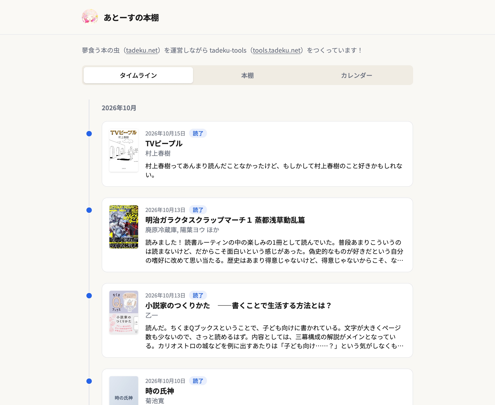
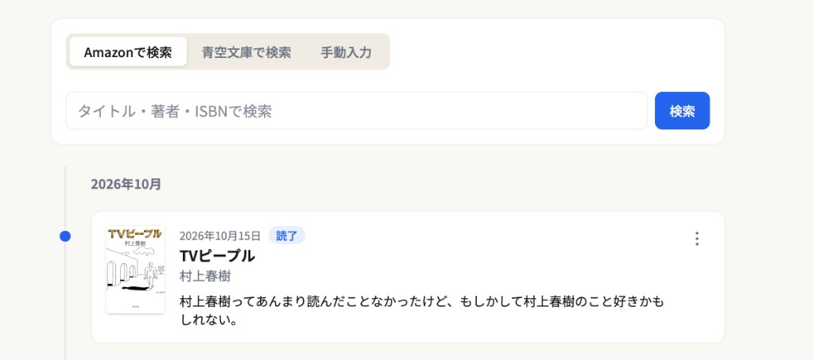
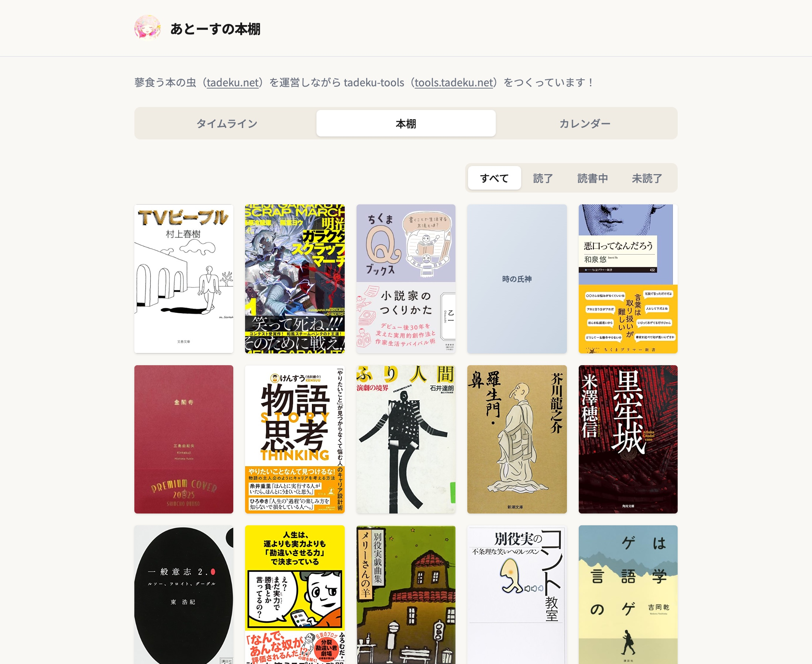
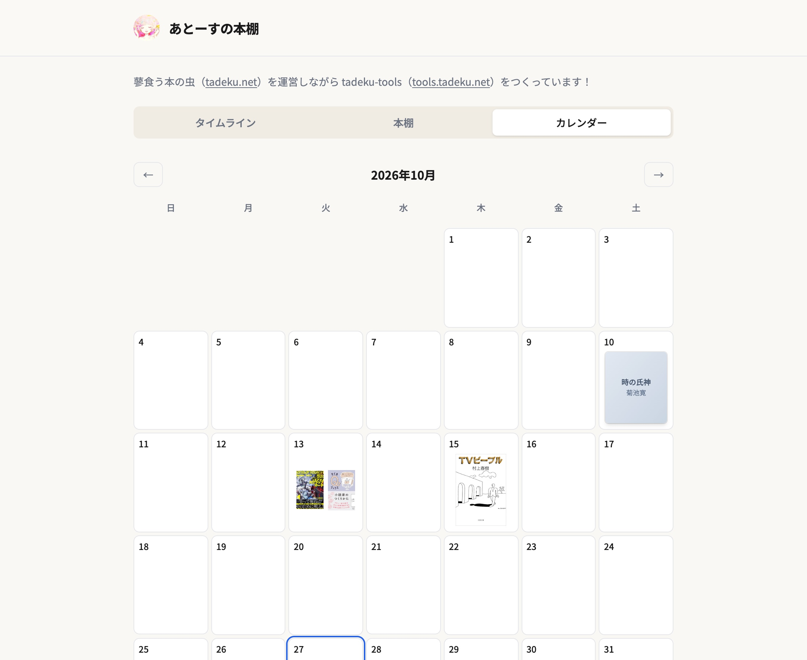
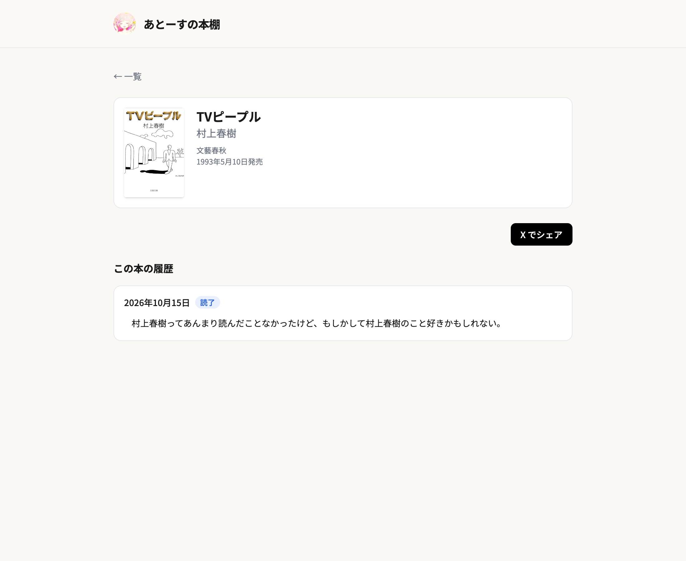
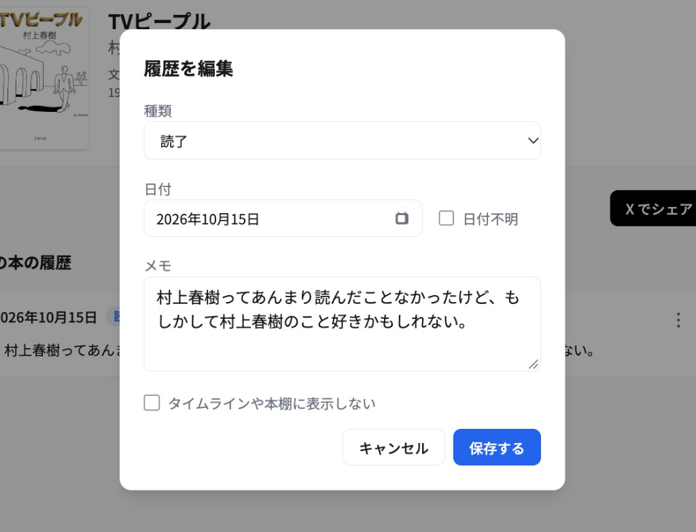
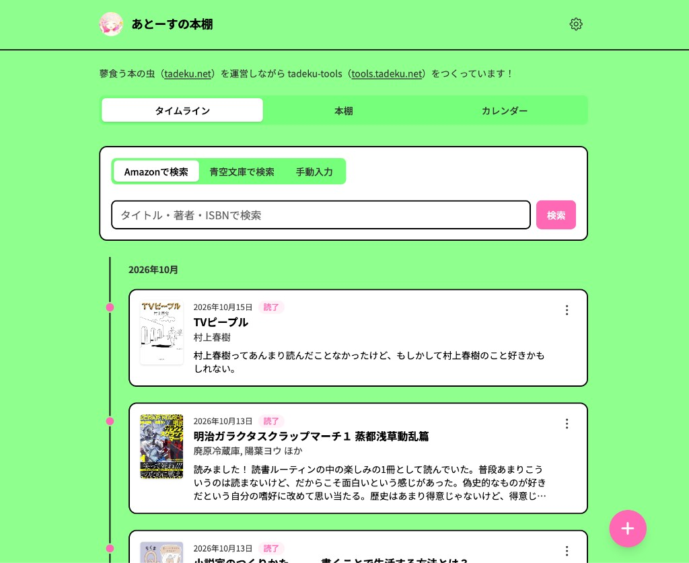

これまで、ブクログや読書メーターといった読書管理アプリを使ってきたのですが、どうも手に馴染まないところがあるなと思っていました。

そこで、それなら自分の理想の読書管理アプリを作ってしまおう、ということで、実際に作ってみています。

以下は、そのアプリケーションで生成した僕の本棚ページになります。

[あとーすの本棚](https://yonda.tadeku.net/atohs)

## 自分が使う機能だけを入れる
ブクログも読書メーターも、どちらも素晴らしいサービスです。僕も長年愛用してきました。

しかし、問題点があるとするならば、どちらも高機能すぎるんですよね。一回も使ったことがない機能がたくさんある。そして、それらの機能への導線が準備されているので、目にする必要のない情報がたくさん並んでいるんます。

これは、多くのユーザーを抱えて運営する上では仕方のないことです。

しかし、自分でアプリケーションを作るのであれば、自分に必要な機能だけを実装できます。というわけで、自分が使う機能だけを入れた、シンプルなアプリケーションを開発してみています。

## 名前は「Yonda」といいます
このアプリケーションは、Yondaという名前で開発しています。ドメインは[yonda.tadeku.net](https://yonda.tadeku.net)です。

新潮社が昔行っていた「Yonda？」というキャンペーンと若干かぶってしまうのですが、まあこちらはもう使っていないようなので、あまり気にせずに使ってみることにしました。名前はそのうち変わるかもしれません。変わらないかもしれません。

## Yondaでできること
ここからは、Yondaにどのような機能があるのかをご紹介します。

### 読了本の登録
Yondaの基本機能は、読み終わった本の登録です。

本は、以下の3種類の形式で登録できます。

- Amazonで検索
- 青空文庫で検索
- 手動入力

#### 「Amazonで検索」について
Amazonでの検索には、Creators APIを使っています。このAPIには、Amazonアソシエイトの売上額に応じて利用上限があるのですが、僕一人で使っていく分には十分すぎるくらいです。大抵の本はAmazon上にデータがあるので、読了した本の登録の9割以上はこれでまかなえます。

#### 「青空文庫で検索」について
既存の読書管理アプリを使っていて不便だなと感じていたのが、青空文庫の作品が登録できないことでした。

一部の作品はAmazonにも登録があるのですが、ほとんどの作品は無いんですよね。でも、青空文庫で読んだ作品も読了登録をしたい。特に、僕は戯曲や短編小説を青空文庫で読むことが多いので、これはぜひとも入れたい機能でした。

そこで、[ブンゴウAPI](https://api.bungo.app/#description/introduction)という、青空文庫の非公式APIを使って検索できるようにしています。

#### 「手動入力」について
そのほか、Amazonや青空文庫で見つからない作品、具体的には同人誌なども登録できるようになっていると良いかなと思い、「手動入力」も設定しています。

ちなみに、まだ使ったことがありません。今後は使いどころがありそうですが。

### 読んだ本をさまざまな方法で表示
読了本は、以下の3つの形式で表示することができます。

- タイムライン
- 本棚
- カレンダー

#### 「タイムライン」について
タイムライン表示では、主に以下の情報が表示されます。

- 読了日
- 書籍情報
- その書籍に対する感想

最近読んだ本と、それに対する感想が分かりやすく並んでいます。

#### 「本棚」について
本棚では、読了した本の表紙画像がタイル状に並んでいます。タイムラインより一覧性が高く、最近読んだ本をざっくりと把握するのに向いています。

なお、「読了」「読書中」「未読了」などステータスごとに表示する機能もつけているのですが、これは今後どうするか考えたいです。後述します。

#### 「カレンダー」について
カレンダー表示では、その日に読んだ本がカレンダーの中に表示されています。

どのくらいのペースで読書ができているかが分かりやすいです。

### 本の履歴
本を登録すると、その本固有のページが作られます。そのページには、その本についての履歴が記録されていきます。

基本的には「読了」の記録が溜まっていくことになります。再読を記録しやすい読書管理アプリケーションって実は意外と少ないので、この機能はYondaの肝になるといっても過言ではありません。

個人的には、本を「読了」することに一番興味があるので、そのステータスが並んでいれば良いのですが、他のステータスも記録できると便利かなというのは少し考えています。

よくあるステータスとしては、「購入した」「読み始めた」とかですかね。「ちょっと読んだ」とかがあっても良いのかもしれません。しかし、読み始めたことを毎回記録するのって面倒だしなあとも思っています。「読了」が一番わかりやすい記録のタイミングなんですよね。読み始めたのに読了しなかった本をどのように表示するのか、というまた難しい問題もあるんですよねえ。

もちろん、ちゃんと管理できる人には有用な機能なのだと思いますが、僕はちゃんと管理できない人間なので、管理しなくてもなるべくいい感じになるように機能を実装したいと考えています。というわけで、今は「読了」以外のステータスを使っていません。

なお、読了の履歴は以下のように編集が可能です。

- 日付不明でも登録できる
- 自分用にのみ記録し、タイムラインや本棚など外部には公開しないように個別設定できる

というのがポイントだったりします。

### 外部公開機能
この記事の最初にも貼りましたが、本棚ページを公開することができます。公開ページの形式は、`yonda.tadeku.net/{ユーザー名}`のようになります。

なお、ログイン状態でyonda.tadeku.netにアクセスすると、自身の公開ページに遷移します。その場合、タイムライン形式の表示画面に書籍登録UIが表示されたり、画面右上に設定ボタンが追加されたりと、さまざまな編集が可能な状態になっています。

外部公開用のページと編集ページをなるべく同じ画面にする、というのも、意識して実装しているポイントです。

### テーマの設定
以下の6つのテーマをとりあえず作ってみました。

- デフォルト
- モノトーン
- パステル
- ビビッド
- ネオン
- ポップ

公開画面・編集画面共に、選んだテーマが適用されます。ちなみに、以下は「ポップ」を選んだ場合の表示です。

### ブクログ形式でのエクスポート
ブクログでインポート可能な形式でエクスポートする機能をつけています。

## Yondaを使ってみたい方へ
ここまで記事を読んで、もしYondaを使ってみたいという方がいらっしゃいましたら、以下のURLにアクセスするとウェイトリストに登録できますので、メールアドレスをご登録いただければと思います。

[yonda.tadeku.net](https://yonda.tadeku.net)

いつ公開するかは特に決まっていないのですが、ステータス周りの仕様が決まったら公開したいな……とはぼんやり思っています。あと、自分でもう少し記録してみたりして、使いづらいところを洗い出したいと思っています。

## 今後追加・調整したい機能
外部にアプリケーションを公開することを前提として、今後追加・調整したい機能について書きます。

### ステータスについて
今は「読了」しかステータスを取り扱っていないのですが、これをどのようにするのか、というのが一番の課題です。

以下のようなことを考えています。

- 読了しか使わない人に、読了以外の導線が表示され続けるのは嫌だな
- 「読み始めた」とかは、読み始めたのに読み終わってないとかが記録されないがちなので嫌だな
  - 何度も「読み始めた」できるようにすればいい？
  - 「最初から読み始めた」みたいなステータスになる？
  - それは名前が長くて嫌だな
- 全体的に、スマートなステータス名にしたいな

### テーマについて
テーマは、もっといっぱい提供したいなと思っています。外部ページをどのような見た目にするのかって個性が出るので。

また、あるテーマをベースにしつつ、色とかを細かく調整できる機能も提供したいなと思っています。

しかし、ここはコア機能ではなさそうなので、他の開発が落ち着いてからかなとは思います。

### ブクログからのインポート機能
僕のYondaの本棚も、ブクログからエクスポートしたファイルをインポートすることで作成しました。

この機能を、アプリケーション上で簡単に操作できるように実装したいと思っています。

### フォロー・フォロワー機能
せっかくなので、フォロー・フォロワー機能もつけようかなと思っています。

以下のようなことを考えています。

- フォロワー数が外部に公開されるような仕組みは嫌だな
  - 自分だけ知れるのは良いかもな
  - 誰にフォローされているのかも分かって良さそう
- フォローしている人の一覧を見れると良さそう
- フォローしている人の最近の活動がタイムライン形式で見れると良さそう
  - カレンダー形式とかで見れても面白いのか？

## ぼちぼち開発していきます
Yondaの開発はかなり片手間で行っており、機能の検討やデバッグは、僕の読書スピードによります。僕が読了しないと、いつまでもYondaのシステムを使えず、検討もデバッグもできないからです。

外部公開するのがいつになるかは分からないのですが、亀の歩みで開発は続けていきたいと思いますので、もし使いたいという方がいらっしゃれば、気長にお待ちください。