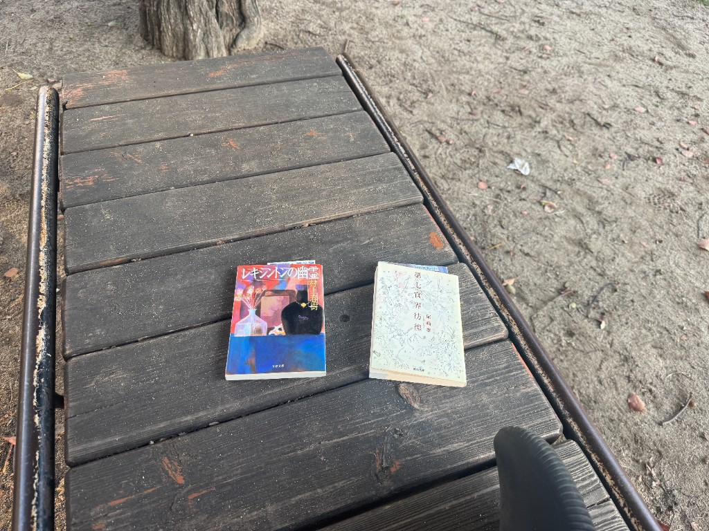

公園で本を読んだ。

まず、尾崎翠[『第七官界彷徨』](https://link.amazon/B06vFJzTJ)を少し読んだ。続いて、村上春樹[『レキシントンの幽霊』](https://link.amazon/B01R2nUNz)を少し読んだ。どちらも少ししか読めなかった。『レキシントンの幽霊』は、表題作を読み終えた。

最近、如実に疲れている。2週間ほど前に熱が出て寝込んで、その後で調子がなかなか戻らない。風邪っぽい感じは全くなく、ずっと肩や首や腰が凝っている感じがする。そう考えると、太もものあたりも痛い気がしてくる。なんだか全身に倦怠感がある。自律神経が参っているのかもしれない。一体どうしたら良いのかわからない。

対策として、ちょっと外に出て体をほぐしたり、日に当たってみている。外で読書をするというのは、つまりそういうことだ。仕事などから離れて、外でぼーっと本を読んでみる。短文ばかり読んでいると疲れる。長文を、できるだけゆっくりと読んでみる。本を読むと、最初は頭に全然入ってこなくていらいらするけど、次第に何を言っているのかが分かってくるようになり、だんだんとその時間の中にいることが心地よくなってくる。おそらく、それはたぶん副交感神経優位な時間だと思うので、そういう時間を意識的に作り出してやらねばならない。

寒くなってきた。日が落ちるのもはやくなった。夕方5時すぎにはもう暗い。本を読むのを切り上げて、近所のスーパーに行く。パスタと炭酸水を買うつもりだった。キャベツが1玉230円で、レモンチキンペッパーのサラダに合いそうなので購入する。鶏むね肉と豚の塊肉も買う。こんなに肉があって食べ切れるのだろうか。おそらく食べ切れる。しかし、微妙に消費期限を過ぎながら消費していくのだろうな、という未来が見える。

買い物から帰ってきたら、すっかり日が暮れてしまった。暗くなったなあ、と思いながら、この文章を書いている。出かける前に洗濯機を回してしまったから、干さなくてはいけない。どうして暗くなる直前に洗濯物を回してしまうのか。19時くらいになったら、パスタを作って食べよう。買ってきた。炭酸水でハイボールを作って飲むかもしれない。しかし、その前にシャワーを浴びておいた方が良いかもしれない。まだ全身が凝っているけど、いくぶんかはすっきりするだろう。あとの時間は何をしよう。今日はもう何もしたくない。しかし、部屋の片付けはしなくてはならない。いや、別に明日でも良いけど、今日できるならしておきたい。久しぶりにラジオでも聴きながら、ゆっくりと部屋の片付けでもしてみようか。