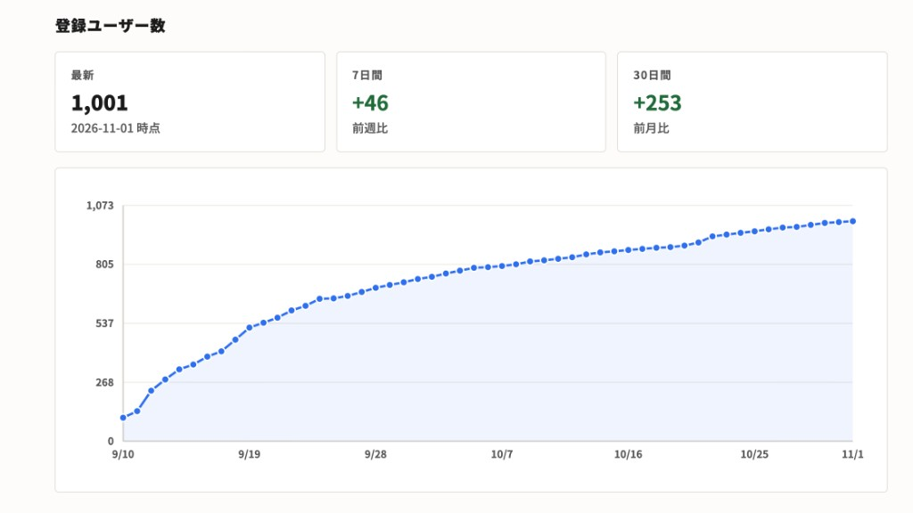

[tadeku-tools https://tools.tadeku.net] という、小説を書くのに役立つツールを集めたサイトを運営しています。

会員登録・ログイン機能があり、ログインすることでさまざまな機能が使えるようになります。このたび、登録ユーザー数が1,000名を超えました！

上記画像のように、登録ユーザー数を日次で記録する仕組みを作り、毎日のようにチェックしておりました。

9月序盤は、[Chara-Zukan https://tools.tadeku.net/chara-zukan/]や[Kaite https://tools.tadeku.net/kaite/]などのツールをリリースしたことで増加ペースが速かったのですが、その後はゆっくりに。しかし、それでも1日に5名前後は登録してくださるという状況でした。

マネタイズの要素がほぼなく、登録ユーザーが増えても今のところは儲からないということもあるのですが、今後は安定運営を目指すためにも、有料機能などを導入したいなとは考えています。でもまあ、1万人を超えるくらいまで待っても良いかもしれません。

## 直近の開発・Inditer

直近では、[Inditer https://tools.tadeku.net/inditer/]という小説執筆ツールの開発に力を入れています。

これは、原稿・メモ・人物・用語集といった情報をひとつのプロジェクトにまとめて管理するというものです。小説執筆の構想を練る段階から、本番原稿の完成までを伴走するということを目標に開発を行っています。

現在はα版となっており、公開しながらも見た目や機能などをかなり大幅に変更しているのですが、今後は安定版として運用することを目指しています。

https://x.com/atohsaaa/status/2112539495216365985?a=2s4cT8xJCZL4Gwey9Ng&s=20

## その他のツール

[Inditer https://tools.tadeku.net/inditer/]以外にも色々なツールを開発しているので、ここで少しご紹介します。

### Chara-Zukan

[Chara-Zukan https://tools.tadeku.net/chara-zukan/]は、自作のキャラクター情報を簡単に管理できるツールです。

ログインなしでもお使いいただけるのですが、ログインすると、図鑑を外部公開する機能をご利用いただけます。

現在は1図鑑のみの公開となっているのですが、ここも拡張していきたいと思っております。ただ、開発の優先度は人気度に依存するという感じなので、気になる方はぜひいっぱい使っていただけると助かります！

### Kaite

[Kaite https://tools.tadeku.net/kaite/]は、小説お題を出題して、それに対する投稿を募ることができるサービスです。ワンライ部屋などを立てて盛り上がるのにおすすめです。

こちらでテキストを書いて投稿できるほか、外部サイトのURLを登録することも可能です。

こちらもぜひ使ってみてください！

## 今後について

他にもたくさんのツールを開発しています。

ログインして遊べる機能も今後たくさん追加していきたいと思いますので、皆さん気になるものがあれば、ぜひ [tadeku-tools https://tools.tadeku.net] を使っていただけると嬉しいです〜！
