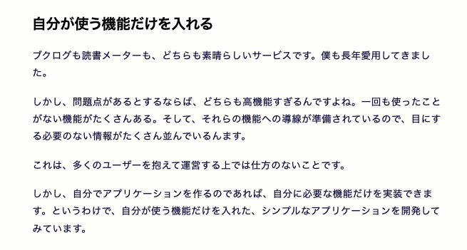
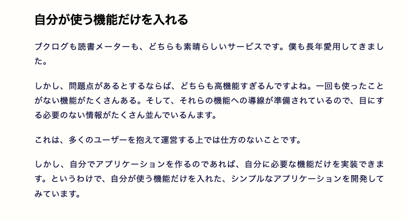
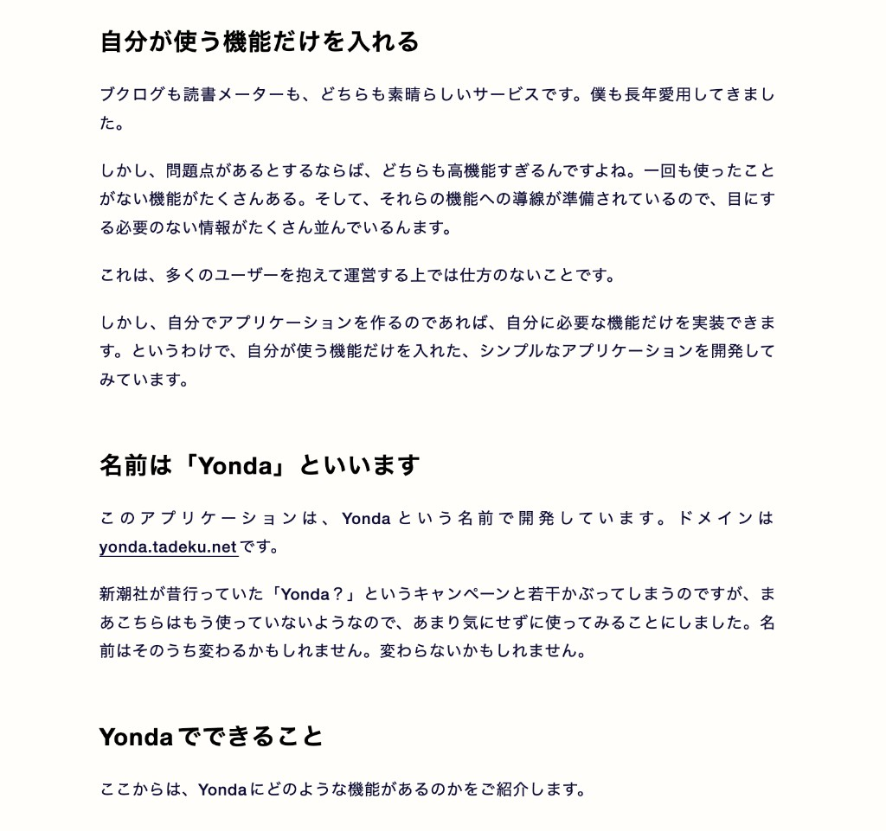
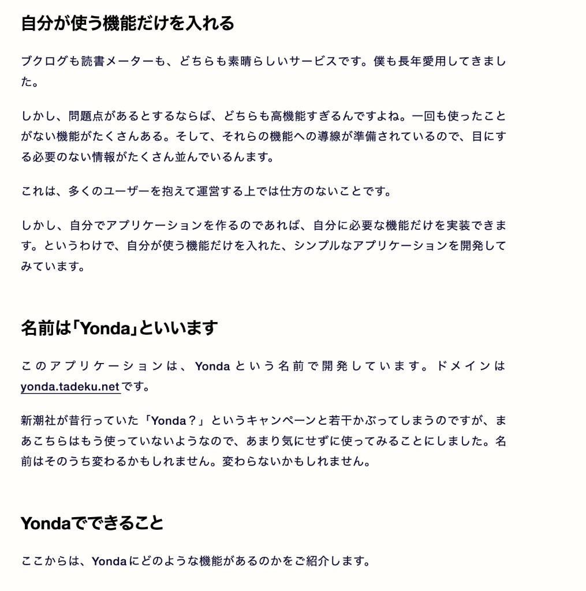

このブログの記事の見た目を、自己満足で微調整しています。自分が好きな見た目なブログになると、読んでいて楽しくなるので。

とはいえ、何が良いのかわからず、1時間後に見るとまた気持ちが変わっていたりするので、微調整をずっと繰り返しています。終わりが見えない。

何を考えながら調整をしているのか、ということを書いていた方が、後の役に立ちそうなので、ここでちょっと書いておきます。

## ブログ記事本文の調整

ブログ記事の本体はもちろん本文です。色々と調整を加えてみています。以下は、調整している箇所のメモです。

### 本文の両端を揃える

`text-align: justify;`を指定して、本文の両端を揃えるようにしています。

<code>text-align: justify;</code>を指定しないとき

<code>text-align: justify;</code>を指定したとき

### 本文と見出しで字間を変える

本文は可読性を高めるために適切に字間を入れています。一方で、見出しの方は、高速スクロールした時の視認性を高めるために、字間を詰めてぎゅっとさせています。

| プロパティ            | 本文   | 見出し       |
| --------------------- | ------ | ------------ |
| letter-spacing        | 0.04em | 0em          |
| font-feature-settings | normal | palt         |
| text-autospace        | normal | no-autospace |

すると、以下のように違いが出ます。

本文と見出しで指定が同じとき

本文と見出しで指定を変えたとき

比べて見てみると、見出しも本文と同じように指定した方がすっきりしているような気もします。

しかし、ずっと読んでいると、見出しは字間を詰めておいた方が見やすいような気がするんですよね。どうなんだろう。気のせいかもしれません。

### 見出しは真っ黒 or 真っ白にする

本文の文字は、ライトモードの時は少し青みがかった感じにしていて、ダークモードの時も真っ白にはしていません。

しかし、見出しについては、ライトモードの時は真っ黒、ダークモードの時は真っ白にしています。こちらの方が、見出しを視認しやすいです。

### 行頭のかぎ括弧を詰める

`text-spacing-trim: trim-start;`を指定しています。

## おわり

他にもいろいろやっている気がするのですが、とりあえずこんな感じです。

あらためて見てみると、見出しを詰めすぎるのも考えものかもしれません。まあしかし、この辺は気分で変えていきたいと思います。
